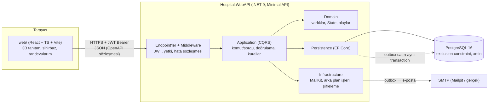
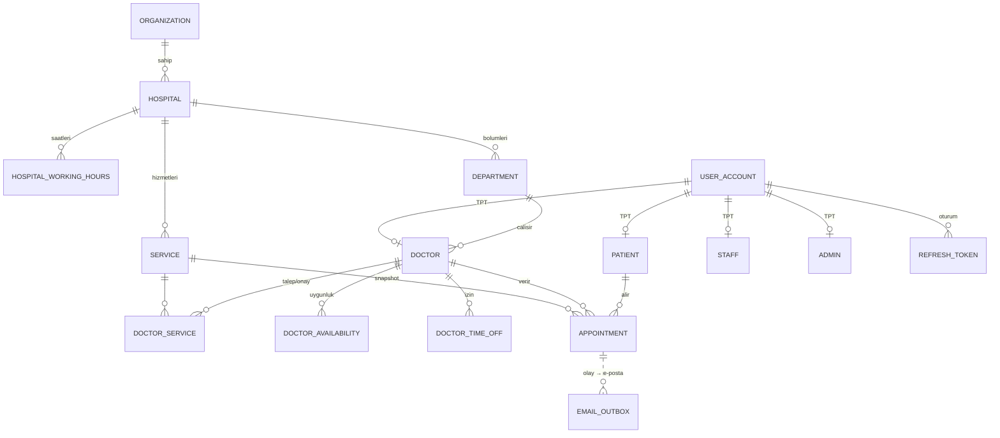

# Proje Raporu — Hastane / Klinik Randevu Sistemi

Ödev sunumunda anlatım için hazırlanmış kapsamlı rapor: mimari, iş akışı, çalışma sistemi, klasörleme, API, backend ve frontend. Tek sayfalık özet için [[sunum-ozeti]]; her başlığın ayrıntısı ilgili wiki sayfasındadır ([[index]]).

---

## 1. Proje nedir?

Çok şubeli (veya tek şubeli) bir hastane/klinik için **randevu yönetim sistemi**:

- **Hasta** şube, hizmet, doktor ve boş saati seçip randevu **talep eder**.
- **Doktor** talebi **onaylar veya reddeder**; hastaya e-posta gider.
- **Yönetici** şube, bölüm, hizmet, doktor/personel ve doktor-hizmet taleplerini yönetir.
- Sistem **çift rezervasyonu** hem uygulamada hem veritabanında engeller.

Ödev (Seçenek A) gereksinimlerinin karşılığı:

| Gereksinim | Çözüm | Nerede |
|---|---|---|
| Tek klinik / çok şube | `ORGANIZATION → HOSPITAL` (tek şube = 1 kurum + 1 şube; kod yolu aynı) | [[veritabani]] |
| Çalışma saatleri, bölümler | `HOSPITAL_WORKING_HOURS`, `DEPARTMENT` | [[veritabani]] |
| Hizmet (ad, süre, ücret) | `SERVICE` | [[veritabani]] |
| Doktor/personel, uzmanlık, sunduğu hizmetler | `DOCTOR`, `STAFF`, `DOCTOR_SERVICE` (talep → yönetici onayı) | [[randevu-kurallari]] |
| Uygunluk dilimleri | `DOCTOR_AVAILABILITY`, `DOCTOR_TIME_OFF` + slot üretimi | [[randevu-kurallari]] |
| Randevu + çakışma kontrolü + onay | Slot ızgarası, uygulama kontrolü, **DB exclusion constraint**, State Pattern | [[randevu-kurallari]] |
| En az 3 rol | Hasta, Doktor (+Personel), Yönetici (şube / süper) | [[kimlik-ve-yetki]] |
| OOP ilkeleri | Kullanıcı hiyerarşisi (TPT), kapsülleme, polimorfizm (State), soyutlama (repository/arayüzler) | [[domain-modeli]] |
| ≥10 commit, farklı günler | 60+ commit, 8 farklı gün (Conventional Commits) | [[git-is-akisi]] |

Sayılarla proje (2026-10-26): **67 API ucu**, **~330 C# kaynak dosyası** (üretilen migration hariç), **76 test dosyası**; **301 birim + 9 mimari + 350 entegrasyon + 21 web testi**.

---

## 2. Sistemin büyük resmi



Üç parça, tek sözleşme: **frontend ↔ API** arasındaki tek bağ dondurulmuş OpenAPI belgesidir (`docs/api/openapi.v1.json`). Frontend tipleri bu dosyadan **üretilir**; sözleşme değişirse hem backend testi hem frontend CI'ı kırılır.

---

## 3. Mimari: Onion Architecture + feature klasörleri

Bağımlılıklar yalnızca **içeriye** doğrudur:

```
                 Hospital.WebAPI  (composition root)
                 /       |        \
   Hospital.Infrastructure |  Hospital.Persistence      ← birbirini bilmez
                 \       |        /
                 Hospital.Application   (use-case'ler, arayüzler)
                          |
                   Hospital.Domain      (hiçbir şeye bağımlı değil)
```

| Halka | Proje | Sorumluluk |
|---|---|---|
| Core | `Hospital.Domain` | Varlıklar, iş kuralları, State Pattern, domain olayları. EF/ASP.NET bilmez. |
| Core | `Hospital.Application` | Command/Query/Handler/Validator, `Result`, arayüzler (`IAppointmentRepository`, `ICurrentUser`, `IUnitOfWork` …), yetki politikaları, DTO. |
| Infrastructure | `Hospital.Infrastructure` | Veritabanı dışı dış dünya: MailKit e-posta, arka plan işleyiciler, AES-GCM şifreleme, parola özeti. |
| Infrastructure | `Hospital.Persistence` | EF Core `AppDbContext`, konfigürasyonlar, migration'lar, repository ve okuma servisleri, seeder. |
| Presentation | `Hospital.WebAPI` | Minimal API endpoint'leri, middleware, JWT/CORS/hız sınırı, OpenAPI, composition root. |

**Neden böyle?** İş kuralı (Domain/Application) çerçeveden bağımsız ve test edilebilir; veritabanı veya e-posta sağlayıcısı değişse çekirdek değişmez. Kural **mimari testlerle** (NetArchTest, 9 test) otomatik zorlanır: Domain hiçbir şeye, Application altyapıya, Infrastructure↔Persistence birbirine bağımlı olamaz; feature'lar birbirinin handler'ına bağlanamaz. Kural ihlali **derleme/test aşamasında** yakalanır.

### Feature klasörleme
Her katmanda **aynı feature adı** bir klasör olur; bir özellik üzerinde çalışan tek bir isim arar, handler'lar tek yerde yığılmaz:

```
Hospital.Application/Features/Appointments/
  Commands/CreateAppointment/   → CreateAppointmentCommand, Handler, Validator
  Commands/ApproveAppointment/
  Queries/GetAvailableSlots/    → Query, Handler, Dto
  IAppointmentRepository.cs     (soyutlama burada)
Hospital.Persistence/Features/Appointments/
  AppointmentRepository.cs, AppointmentConfiguration.cs, AppointmentReader.cs   (somut burada)
Hospital.WebAPI/Features/Appointments/
  AppointmentEndpoints.cs
```

Feature'lar: Auth, Organizations, Hospitals, Departments, Services, Catalog, Doctors, StaffMembers, Admins, Patients, Users, Appointments, Notifications. Handler'lar (Mediator source generator), endpoint'ler (`IEndpoint` taraması) ve EF konfigürasyonları (`IEntityTypeConfiguration` taraması) **otomatik kaydolur**: yeni feature eklemek ortak dosyaya dokunmaz → iki kişilik ekipte birleştirme çakışması azalır.

### DI kuralı
Her katman kendi `Extensions/<Katman>Ext.cs` dosyasında `Add<Katman>` ile kaydolur (`AddApplication`, `AddInfrastructure`, `AddPersistence`, `AddWebApi`); `Program.cs` yalnızca bunları çağırır ([[di-kurallari]]).

---

## 4. Depo (klasör) yapısı

```
P027-Hastane_Yonetim_Sistemi/
├─ src/
│  ├─ Core/
│  │  ├─ Hospital.Domain/            Entities/{Users,Facility,Appointments,Notifications}, Common/
│  │  └─ Hospital.Application/       Features/*, Interfaces/, Behaviors/, Security/, Validation/, Parameters/, Wrappers/
│  ├─ Infrastructure/
│  │  ├─ Hospital.Infrastructure/    Features/{Notifications,Appointments}, Security/, Extensions/
│  │  └─ Hospital.Persistence/       Context/, Features/*, Migrations/, Seeding/, DataUpgrades/, UnitOfWorks/
│  └─ Presentation/
│     └─ Hospital.WebAPI/            Features/*, Common/ (middleware, hata), Extensions/ (DI, OpenAPI, auth), Program.cs
├─ tests/
│  ├─ Hospital.UnitTests/            domain, validator, slot hesabı, şifreleme
│  ├─ Hospital.ArchitectureTests/    NetArchTest katman kuralları
│  └─ Hospital.IntegrationTests/     WebApplicationFactory + gerçek PostgreSQL + Mailpit
├─ web/                              React + TS + Vite arayüz (src/{api,auth,components,pages,lib,three,test})
├─ docs/
│  ├─ wiki/                          LLM Wiki: bilgi tabanı (bu rapor dahil), index.md, log.md
│  └─ api/openapi.v1.json            DONDURULMUŞ API sözleşmesi
├─ scripts/                          smoke-test.sh, test-docker.ps1, update-openapi-snapshot.ps1
├─ .github/workflows/ci.yml          CI: backend (build+test) ve web (lint, test, tip farkı, build)
├─ Dockerfile, docker-compose.yml, docker-compose.app.yml
├─ CLAUDE.md                         Çalışma anayasası (wiki kuralları, kodlama kuralları)
├─ plan.md, Fazlar.md                Onaylı kaynak spesifikasyon
└─ README.md
```

---

## 5. Backend nasıl çalışır?

### 5.1 Bir isteğin yolu (örnek: hasta randevu talep ediyor)
```
POST /api/appointments  (Authorization: Bearer <JWT>)
 1. CorrelationIdMiddleware      → X-Correlation-Id atar/korur, log kapsamı
 2. Kimlik doğrulama + politika  → JWT geçerli mi, security_stamp güncel mi, rol "Patient" mi
 3. Endpoint                     → gövdeyi CreateAppointmentCommand'a çevirir, ISender.Send
 4. LoggingBehavior              → komut adı + süre
 5. ValidationBehavior           → FluentValidation; hata → handler'a girmeden Result (400)
 6. CreateAppointmentHandler     → hasta kimliği ICurrentUser'dan; hizmet/doktor/şube kontrolü;
                                   SlotAvailabilityService: istenen saat gerçekten müsait mi?
                                   Appointment.Create(...)  → Pending, snapshot (hizmet adı/süre/ücret)
 7. IUnitOfWork.SaveChanges      → AppDbContext, olayları toplar; olay dinleyicisi aynı transaction'da
                                   email_outbox satırı ekler; PostgreSQL exclusion constraint son kapı
 8. Result<Guid> → 201 {id}      → hata ise ProblemDetails (Türkçe başlık, code, traceId)
 (arka planda) EmailOutboxProcessor → e-postayı SMTP'ye gönderir
```
Beklenen hatalar (`slot_taken`, `invalid_transition`…) istisna değil `Result`/`Error` ile döner; beklenmeyen istisnaları tek `GlobalExceptionHandler` yakalar ([[hata-yonetimi]]).

### 5.2 Domain ve OOP
- **Kullanıcı hiyerarşisi (TPT):** `User` soyut taban → `Patient`, `Doctor`, `Staff`, `Admin`; ortak alanlar `user_account`, türe özgü alanlar ayrı tablolarda ([[domain-modeli]]).
- **Kapsülleme:** setter'lar private, durum değişimi yalnız davranış metotlarıyla (`Approve`, `Reject`, `Cancel`…); geçersiz durum üretilemez.
- **State Pattern:** `AppointmentState` soyut taban + `Pending/Approved/Rejected/Cancelled/Completed`; geçerli geçişi durum sınıfı belirler, `if/else` zinciri yok. Handler önce `Allows(action)` ile denetler (anlaşılır 409), domain ikinci savunmadır.
- **Domain olayları:** `Appointment` olay üretir (`Requested/Approved/Rejected/Cancelled`); dağıtım `SaveChanges` içinde.
- **Saf fonksiyon:** `SlotCalculator` I/O yapmaz; saat dilimine ve yaz saati geçişine (DST) duyarlıdır → kolay ve kesin test.

### 5.3 Randevu ve çakışma güvencesi (en kritik kısım)
1. **Slot üretimi:** doktor uygunluğu ∩ şube çalışma saati → ızgara (15 dk) → izin ve dolu randevular elenir → hazırlık süresi (60 dk) ve ufuk (60 gün) uygulanır.
2. **Uygulama kontrolü:** `StartAt`, üretilen slotla **birebir** eşleşmeli; bitiş sunucuda hesaplanır (istemci süre/ücret dayatamaz).
3. **Veritabanı kısıtı:** PostgreSQL `EXCLUDE USING gist` (`btree_gist`) — aynı doktor için çakışan aktif randevu **fiziksel olarak** eklenemez. Hasta için de aynı saatte iki doktor engellenir.
4. **Yarış:** iki kişi aynı anda aynı saati alırsa kaybeden `409 appointment.slot_taken` alır; testte 20 paralel istek → **1×201, 19×409**. Durum geçişleri `xmin` iyimser eşzamanlılık belirteciyle korunur.
5. **Snapshot:** randevu anındaki hizmet adı/süre/ücret kopyalanır; sonradan fiyat değişse geçmiş değişmez.

### 5.4 Güvenilir bildirim: Transactional Outbox
Ağ çağrısı (SMTP) istek yolunda **yoktur**. Randevu kaydıyla e-posta kaydı (`email_outbox`) **tek transaction'da** yazılır: ya ikisi birden, ya hiçbiri. `EmailOutboxProcessor` (BackgroundService) satırları `FOR UPDATE SKIP LOCKED` ile alır (çok örnekte çift gönderim yok), başarısızlıkta üstel geri çekilmeyle yeniden dener, 5 denemede `FAILED` yapar. `dedup_key` aynı olaydan iki e-posta çıkmasını önler. SMTP kapalıyken randevu akışı bozulmaz ([[bildirimler]]).

### 5.5 Güvenlik
- **JWT Bearer:** HS256, 15 dk erişim belirteci + 7 gün **döndürülen** (rotation) refresh token; DB'de yalnız SHA-256 özeti; yeniden kullanım tespiti. Her istekte `security_stamp` doğrulanır → parola değişince/pasifleştirilince eski token'lar ölür.
- **4 savunma katmanı:** (1) uç noktada açık politika (`Patient/Doctor/Admin/SuperAdmin` — politikasız uç testte kırılır), (2) şube kapsamı (`AdminScope`; kapsam dışı kaynak **404**, varlığı sızmaz), (3) kaynak sahipliği handler'da (başkasının randevusu 404 — IDOR koruması), (4) DB kısıtları.
- **KVKK:** T.C. kimlik no veritabanında **AES-256-GCM** ile şifreli, arama için HMAC **kör indeks**, yanıtta maskeli (`102******12`), loglanmaz. Şifreleme anahtarı ortam değişkeni; yoksa uygulama **başlamaz**.
- Parola PBKDF2, hız sınırı (kimlik uçlarında IP başına), CORS yalnız listelenen origin'ler, ProblemDetails'te iç ayrıntı sızmaz.
- **Matris testleri:** 67 uç × 6 kimlik (anonim, hasta, doktor, personel, şube yöneticisi, süper yönetici) otomatik denenir.

### 5.6 Veri modeli (özet)

Tüm kimlikler `uuid` (Guid v7: tahmin edilemez, sıralı), zamanlar `timestamptz` UTC, para `numeric(12,2)`. Randevusu olan kayıtlar silinmez (`RESTRICT`), pasifleştirilir. Ayrıntı: [[veritabani]].

---

## 6. API

- **Minimal API**, kaynak odaklı rotalar; rol URL'de değil token'dadır (`/api/doctors/me`, `/api/patients/me/appointments`). Toplam **67 uç**, tam liste [[api-uc-noktalari]].
- **Hata sözleşmesi:** tüm hatalar `application/problem+json`: Türkçe `title`, makine okunur `code` (`appointment.slot_taken`), `traceId`, doğrulamada alan bazlı `errors` ([[hata-yonetimi]]).
- **İzleme:** her yanıtta `X-Correlation-Id`; hata gövdesindeki `traceId` ile aynı → şikâyet tek kimlikle loglardan bulunur.
- **Sayfalama:** `?page=&pageSize=` (en çok 200); gövde dizi kalır, toplam `X-Total-Count`, `X-Page`, `X-Page-Size` başlıklarında.
- **OpenAPI + Scalar:** her uç Türkçe özet, gereken yetki ve olası hata yanıtlarıyla belgelenir; belge **dondurulmuştur** (`docs/api/openapi.v1.json`), sözleşme testi farkı yakalar. Geliştirmede `/scalar/v1`, "Authorize"a access token yapıştırılır.
- Örnekler ve smoke test: [[api-ornekleri]].

---

## 7. Frontend (`web/`)

**Yığın:** React 19, TypeScript, Vite, React Router, three.js (React Three Fiber), Vitest + Testing Library. Ayrıntı: [[arayuz]].

### 7.1 Ekranlar
| Rota | Ne yapar |
|---|---|
| `/` | Kaydırdıkça değişen **3B tanıtım**: iki sarmal şerit kaydırmayla döner, renk değiştirir, kameraya yaklaşır; 4 bölüm metni normal HTML |
| `/giris`, `/kayit` | JWT girişi, hasta kaydı (alan bazlı hata gösterimi) |
| `/randevu-al` | **Sihirbaz:** şube → hizmet → doktor → tarih → saat → özet/talep. Katalog anonim gezilir, talep gönderirken giriş istenir; seçimler korunur |
| `/randevularim` | Durum filtresi, sayfalama, iptal nedeniyle iptal (giriş gerekir) |

### 7.2 Oturum ve API katmanı
- **Erişim belirteci bellekte**, yenileme belirteci `sessionStorage`'da. Süre dolunca (401) istemci **tek** yenileme isteği atar (eşzamanlı istekler paylaşır — döndürülen refresh token iki kez kullanılırsa sunucu bunu saldırı sayar) ve asıl isteği tekrarlar. Yenileme de reddedilirse oturum temizlenir, kullanıcı giriş sayfasına düşer.
- **Tipler üretilir:** `npm run gen:api` → `docs/api/openapi.v1.json` → `src/api/schema.d.ts`. Elle yazılmış tip kayması olmaz; CI üretimi tekrarlayıp fark varsa kırılır.
- Sayfa kilitleri (`ProtectedRoute`) **yalnız görseldir**; asıl koruma backend'dedir (401/403/404).
- Tarih `yyyy-MM-dd` yerel tarihten üretilir, saatler şubenin saat diliminde gösterilir.

### 7.3 3B ve erişilebilirlik dengesi
- Tuval **sticky ve `aria-hidden`**, metinler gerçek HTML, kaydırma **yerel sayfa kaydırması** → klavye, ekran okuyucu, kaydırma çubuğu bozulmaz.
- **Sade mod:** hareket azaltma tercihi, zayıf cihaz (≤2 çekirdek/≤2 GB) veya WebGL yoksa otomatik; üst çubuktan elle de açılır/kapanır. Sahne çökerse düz sayfaya düşer. Three.js yalnız ana sayfada, tembel yüklenir.
- Atla bağlantısı, odak halkası, `role="alert"` hata mesajları, açık/koyu tema, mobilde uyumlu düzen.

---

## 8. Çalışma sistemi ve iş akışı

### 8.1 Fazlı geliştirme
| Faz | Konu | Sonuç |
|---|---|---|
| 0 | İskelet, LLM wiki | Çözüm yapısı, CI, anayasa |
| 1 / 1B | Kimlik + çakışma spike'ı | JWT, TPT; exclusion constraint ve 20 paralel istek kanıtı |
| 2 | Kurum modülü | Şube, saat, bölüm, hizmet, yönetici kapsamı |
| 3 | Çalışanlar ve profiller | Doktor/personel, talep→onay, uygunluk/izin |
| 4 | **Randevu çekirdeği** | Slot, State Pattern, onay akışı, yarış testleri |
| 5 | Bildirimler | Outbox + MailKit + Mailpit |
| 6 | Sağlamlaştırma | Matris testleri, OpenAPI dondurma, KVKK şifreleme, sayfalama, Docker |
| 7 | Arayüz (ilk dilim) | 3B tanıtım, giriş, sihirbaz, randevularım |

Her faz: **kod + test + wiki + commit** birlikte biter; çıkış kriteri fazın sonunda doğrulanır ([[faz-plani]]). Backend tamamlanıp sözleşme dondurulduktan sonra arayüze geçilmiştir.

### 8.2 Git ve CI
- `main` korunur; `feature/<ad>` dalı → PR/fast-forward. **Conventional Commits** (`feat(appointments): …`, `fix`, `test`, `docs`, `build`, `ci`), her faz birkaç anlamlı commit ([[git-is-akisi]]).
- **CI (GitHub Actions):** *backend* işi gerçek PostgreSQL ve Mailpit servisleriyle `dotnet build` + `dotnet test`; *web* işi `lint`, `test`, API tip farkı denetimi ve `build`.
- Windows'ta güvenlik yazılımı yerel test DLL'lerini engelleyebildiği için testler Linux container'da da çalıştırılabilir (`scripts/test-docker.ps1`).

### 8.3 Test stratejisi (piramit)
| Katman | Araç | Neyi kanıtlar |
|---|---|---|
| Birim (301) | xUnit, AwesomeAssertions | Domain kuralları, State geçişleri, slot hesabı (DST dahil), validator'lar, AES-GCM |
| Mimari (9) | NetArchTest | Katman bağımlılık kuralları |
| Entegrasyon (350) | `WebApplicationFactory` + **gerçek PostgreSQL** + Mailpit | Uçtan uca akışlar, yarış durumu, yetki matrisi, IDOR, sözleşme, sorgu planı (EXPLAIN), şifreleme |
| Web (21) | Vitest + Testing Library | http istemcisi (yenileme/yarış), yardımcılar, uygulama akışları |
| Canlı smoke | `scripts/smoke-test.sh` | Çalışan (container) API'ye karşı 57 kontrol, e-postalar dahil |

Testle yakalanan gerçek hatalar (öğrenilenler): kültüre bağlı tarih ayrıştırma (`02.11.2026` → 11 Şubat) → yalnız `yyyy-MM-dd`; hata `traceId`'sinin korelasyon kimliğinden farklı çıkması; EF modelinin ilk şifreleyiciyi önbelleğe alması; drei `<Scroll html>`'in ayrı React kökünde Router bağlamını kaybetmesi → sticky tuval mimarisi.

### 8.4 LLM Wiki ile sürdürülebilir bilgi
Proje, bir yapay zekâ asistanıyla geliştirildi ve bağlam kaybı olmasın diye `docs/wiki/` **bilgi tabanı** tutuldu: `CLAUDE.md` (anayasa) → `index.md` (harita) → birbirine Obsidian tarzı çift köşeli bağlantılarla bağlı konu sayfaları, `log.md` (kronoloji) ve `kararlar.md` (**K-1…K-75**, her kararın tarihi ve gerekçesi). Kod yazmadan önce wiki okunur, karar çıkınca wiki güncellenir; kaynak spesifikasyonla (`plan.md`, `Fazlar.md`) çelişki sessizce çözülmez, onaya sunulur. Sonuç: karar gerekçeleri kayıpsız, sunumda "neden böyle yaptık" sorusunun her cevabı belgeli ([[kararlar]]).

---

## 9. Çalıştırma ve demo

```bash
docker compose up -d                                   # PostgreSQL + Mailpit
dotnet run --project src/Presentation/Hospital.WebAPI  # API  http://localhost:5284  (Scalar: /scalar/v1)
cd web && npm install && npm run dev                   # Arayüz http://localhost:5173
# Hepsi container'da: docker compose -f docker-compose.yml -f docker-compose.app.yml up -d --build   (API :8080)
```
Geliştirmede örnek veri hazırdır: süper yönetici `admin@hastane.local`, örnek doktor `doktor@hastane.local` (parolalar `appsettings.Development.json`'da). E-postalar `http://localhost:8025` (Mailpit).

**5 dakikalık demo akışı**
1. Ana sayfayı kaydır (3B sahne, 4 bölüm); "Sade mod" düğmesini göster.
2. Kayıt ol → Randevu al: şube → hizmet → doktor → tarih → saat (anonim gezilebilir olduğunu belirt).
3. "Randevu talep et" → Randevularım'da **Onay bekliyor**; Mailpit'te hasta ve doktor e-postaları.
4. Scalar/curl ile doktor girişi → `approve` → hastaya e-posta; aynı slota ikinci talep → `409 appointment.slot_taken`.
5. Hasta token'ıyla yönetici ucu → `403`; başkasının randevusu → `404`.
6. Yanıt başlığında `X-Correlation-Id`, hata gövdesinde aynı `traceId`.
7. `./scripts/test-docker.ps1` veya CI sonucu: yeşil test özeti.

---

## 10. Hocanın sorabileceği sorular

| Soru | Kısa cevap |
|---|---|
| Çift rezervasyonu nasıl engellediniz? | Uygulama kontrolü + PostgreSQL exclusion constraint; kaybeden 409 alır; 20 paralel istek testi. |
| Neden Onion + feature klasörleri? | Çekirdek çerçeveden bağımsız ve test edilebilir; feature klasörü bir özelliği tek yerde toplar; mimari testlerle zorlanır. |
| Doktor onaylamazsa/yanıtlamazsa? | Reddedebilir; 48 saat yanıtsız kalan talep arka plan işiyle otomatik reddedilir, slot serbest kalır, hastaya e-posta gider. |
| E-posta gitmezse randevu kaybolur mu? | Hayır: Outbox ile randevu ve e-posta kaydı aynı transaction'da; işleyici yeniden dener. |
| Başka hastanın randevusunu görebilir miyim? | Hayır: sahiplik handler'da kontrol edilir, varlığı sızdırılmaz (404); IDOR matris testi var. |
| Güvenlik: token çalınırsa? | Erişim belirteci 15 dk; refresh döndürülür ve yeniden kullanım tespit edilir; parola değişince `security_stamp` hepsini geçersiz kılar. |
| Kişisel veri? | T.C. kimlik no şifreli + kör indeks + maskeli yanıt; anahtar ortam değişkeni, yoksa uygulama başlamaz. |
| Frontend backend ile nasıl uyumlu kalıyor? | Dondurulmuş OpenAPI → üretilen TypeScript tipleri; CI uyumsuzlukta kırılır. |
| 3B sahne yavaş cihazda? | Sade mod otomatik açılır, three.js tembel yüklenir, içerik zaten gerçek HTML. |
| Neden MediatR değil? | MediatR v13+ ticari lisanslı; `Mediator` (source generator) hem ücretsiz hem hızlı. |
| Test gerçek veritabanı mı? | Evet; EF InMemory kısıtları (exclusion, xmin) taklit edemez, bu yüzden gerçek PostgreSQL geçici veritabanı. |

---

## 11. Sınırlar ve gelecek çalışma
- Arayüzde doktor onay paneli ve yönetici paneli henüz yok (API hazır, Faz 7'nin sonraki dilimleri).
- Veri şifreleme anahtarı döndürme (rotation) yok; anahtar yedeklenmelidir. Denetim izi (audit log) ve kullanıcı bazlı hız sınırı yok.
- Sayfalama sayfa numarası tabanlıdır (ödev ölçeğinde yeterli).
- Web için üretim imajı (statik dosya + ters vekil) henüz eklenmedi; `npm run build` `web/dist` üretir.
- 3B sahne bilinçli olarak sade tutuldu (çift sarmal); steteskop/doktor modelleri denendi, kalite yeterli bulunmayıp kaldırıldı ([[kararlar]] K-74).

İlgili sayfalar: [[mimari]], [[tasarim-kaliplari]], [[teknoloji-yigini]], [[randevu-kurallari]], [[bildirimler]], [[operasyon]], [[test-stratejisi]], [[arayuz]], [[faz-plani]].
