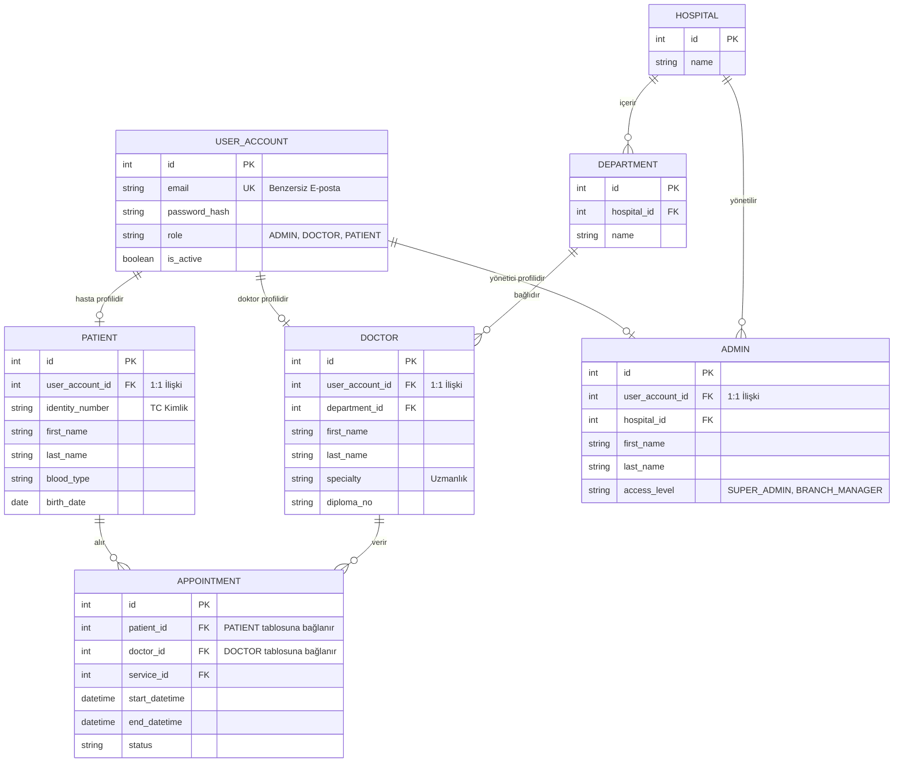

Aşağıda, konuştuğumuz tüm detayları, mimari kararları ve teknik yaklaşımları içeren, doğrudan projenizin dokümantasyonuna (README.md veya Wiki) ekleyebileceğiniz profesyonel bir Markdown raporu sunulmuştur. Belirttiğiniz üzere **Strategy** ve **Factory** kalıpları rapordan çıkarılmıştır.

---

# HASTANE VE KLİNİK RANDEVU SİSTEMİ GELİŞTİRME RAPORU

## 1. Proje Özeti ve Amacı

Bu proje, platform bağımsız (C#, Java vb. dillerle uygulanabilir) nesneye dayalı programlama (OOP) ilkelerine sadık kalarak, çok şubeli hastane ve klinik yapılarını destekleyebilecek ölçeklenebilir bir Randevu Yönetim Sistemi geliştirmeyi amaçlamaktadır. Sistem; yetkilendirme, kurum/çalışan yönetimi, çakışma kontrollü randevu yönetimi ve rol bazlı erişim mekanizmalarını içerecektir.

## 2. Proje Geliştirme Yol Haritası

Projeyi başarılı bir şekilde canlıya almak için aşağıdaki altı aşamalı yol haritası izlenecektir:

* **Aşama 1: OOP Mimarisinin Tasarlanması:** Sistemdeki varlıkların Kalıtım, Kapsülleme ve Çok Biçimlilik ilkelerine göre soyutlanması.
* **Aşama 2: Veritabanı ve Altyapı:** "Table Per Type" (Tipe Göre Tablo) yaklaşımı ile ER diyagramının RDBMS (PostgreSQL, SQL Server vb.) üzerine kurulması.
* **Aşama 3: Çekirdek İş Mantığı (Business Logic):** Hastane, klinik, departman işlemleri ile çakışma algoritmalarının kodlanması.
* **Aşama 4: API ve Güvenlik Katmanı:** RESTful API uç noktalarının oluşturulması ve JWT (JSON Web Token) ile rol bazlı yetkilendirmenin eklenmesi.
* **Aşama 5: Kullanıcı Arayüzü (UI) Entegrasyonu:** Randevu takvimi ve doktor uygunluk durumlarını görselleştiren arayüzlerin sisteme bağlanması.
* **Aşama 6: Test ve Dağıtım:** Birim (Unit) testlerin yazılması (özellikle çakışma durumları için) ve uygulamanın sunucu/bulut ortamına dağıtımı.

---

## 3. Backend Mimari Yaklaşımı

Hastane randevu sistemi gibi hem yüksek trafik potansiyeli olan hem de randevu çakışması gibi karmaşık iş kuralları içeren bir proje için **"Modüler Monolitik (Modular Monolithic) ve Clean Architecture"** tercih edilmiştir.

### Neden Modüler Monolitik?

* **Mikroservislere Kıyasla:** Dev ekipler için tasarlanan mikroservislerin getirdiği dağıtık yapı zorluklarını, iletişim maliyetlerini ve DevOps karmaşasını engeller. Öğrenme ve geliştirme eğrisi daha pratiktir.
* **Geleneksel Monolitiğe Kıyasla:** Kodun spagettiye dönüşmesini engeller. Proje "İş Alanlarına" (Bounded Contexts) göre ayrıldığı için randevu modülündeki bir hata tüm hastane yönetim sistemini çökertmez.
* **Geleceğe Hazırlık:** Clean Architecture katmanlarına uygun (Domain, Application, Infrastructure, Presentation) ve modülleri birbirinden bağımsız tasarlandığı için ileride ihtiyaç duyulursa bir modül (ör: Randevu Modülü) kolayca mikroservise dönüştürülebilir.

---

## 4. Veritabanı Mimarisi (Table Per Type)

Kullanıcı rolleri (Admin, Hasta, Doktor) arasında ciddi veri farklılıkları bulunduğu için nesne-ilişkisel uyumsuzluğunu (Impedance Mismatch) çözmek adına **Table Per Type (Tipe Göre Tablo)** yaklaşımı benimsenmiştir. Kimlik doğrulama işlemleri merkezi bir `USER_ACCOUNT` tablosunda tutulurken, role özel veriler bağımsız tablolarda tutulmaktadır.

### ER Diyagramı

---

## 5. Kullanılacak Tasarım Kalıpları (Design Patterns)

Projenin teknik borç (technical debt) yaratmadan ölçeklenebilmesi için aşağıdaki tasarım kalıpları sisteme entegre edilecektir:

### 5.1. Repository ve Unit of Work Pattern

* **Amaç:** Veritabanı sorgularını iş mantığından soyutlamak ve işlem bütünlüğünü (Transaction) sağlamak.
* **Kullanım Yeri:** Hastane ekleme, bölüm (departman) tanımlama, temel kullanıcı profili güncelleme gibi standart **CRUD (Create, Read, Update, Delete)** işlemleri. Unit of Work sayesinde birden fazla tabloyu (örn: User_Account ve Patient) kapsayan kayıt işlemleri atomik olarak yürütülür; hata anında geri alınır (Rollback).

### 5.2. CQRS (Command Query Responsibility Segregation) ve Mediator Pattern

* **Amaç:** Okuma ve yazma işlemlerini mantıksal olarak birbirinden ayırmak, API (Controller) sınıflarını hafifletmek (Decoupling).
* **Kullanım Yeri:** **Randevu Onaylama, Çakışma Kontrollü Randevu Oluşturma** gibi karmaşık işlemlerde (Commands) kullanılır. API sadece isteği alır ve Mediator'a iletir. Mediator doğru işleyiciyi (Handler) bularak ağır iş kurallarının Controller'ı kirletmesini engeller. Randevu listeleme gibi sorgu (Query) işlemleri ise DTO'lar ile doğrudan hızlıca veritabanından okunur.

### 5.3. State Pattern (Durum Kalıbı)

* **Amaç:** Karmaşık durum geçişlerini `if-else` blokları yerine, nesnelere devretmek.
* **Kullanım Yeri:** Randevu Durum Yönetimi. Bir randevunun `Pending` (Bekliyor), `Approved` (Onaylandı), `Cancelled` (İptal) veya `Completed` (Tamamlandı) durumları için ayrı State sınıfları oluşturulur. İptal edilmiş bir randevunun tamamlandı statüsüne çekilememesi gibi kurallar, kendi State sınıfı içerisinde güvenle kontrol edilir.

### 5.4. Observer Pattern / Domain Events

* **Amaç:** Sistemde meydana gelen önemli değişiklikler sonucunda diğer bileşenleri (yan etkileri) haberleşme yoluyla tetiklemek.
* **Kullanım Yeri:** Randevu onaylandığında veya iptal edildiğinde (CQRS Handler işlemi başarıyla bittiğinde) sistem bir `AppointmentApprovedEvent` fırlatır. Bunu dinleyen servisler (örneğin e-posta veya SMS servisi) hastaya asenkron olarak bildirim gönderir. Böylece ana akış (randevu kaydetme süresi) bildirim bekleme sürelerinden etkilenmez.