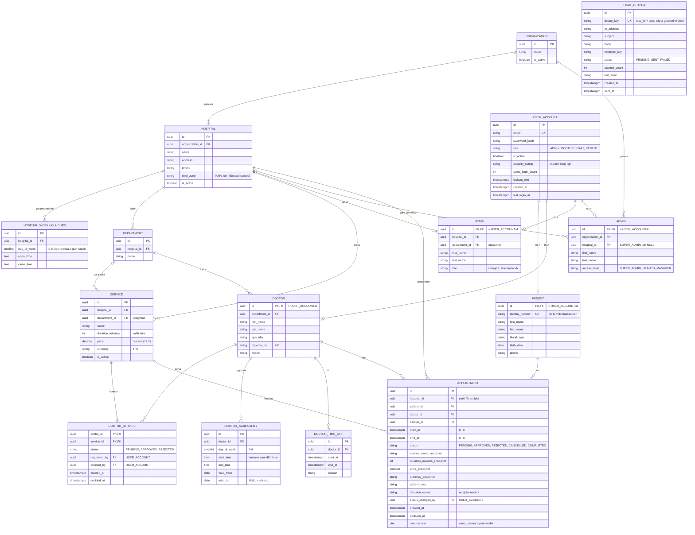
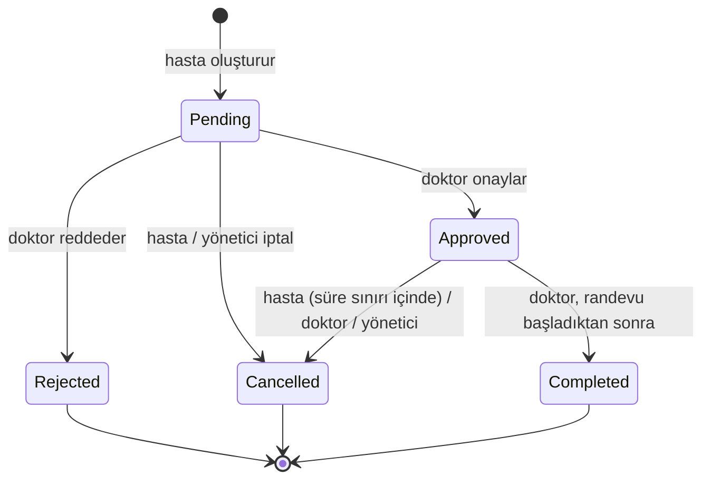

# HASTANE VE KLİNİK RANDEVU SİSTEMİ — TASARIM VE GELİŞTİRME PLANI

> Sürüm: 3.0 (revize). Bu doküman projenin tek referans mimari belgesidir. Faz bazlı iş sırası için bkz. [Fazlar.md](Fazlar.md).

## 1. Proje Özeti

Çok şubeli hastane/klinik yapılarını da, tek şubeli bir kurumu da destekleyen bir **Randevu Yönetim Sistemi**. Sistem; cookie tabanlı kimlik doğrulama, rol bazlı yetkilendirme, kurum/çalışan/hizmet yönetimi, doktor uygunluk takvimi, çakışma kontrollü randevu ve doktor onay mekanizması içerir. Randevu olaylarında hastaya (ve doktora) e-posta gönderilir.

- **Backend:** .NET 9, Onion (Clean) Architecture + feature klasörlü monolit, Minimal API
- **Veritabanı:** PostgreSQL 16 (Docker)
- **Arayüz:** Backend tamamlandıktan sonra, Three.js ile scroll tabanlı animasyonlu akış (bkz. Fazlar.md, son faz)
- **Ödev kapsamı:** Seçenek A (Hastane/Klinik Randevu Sistemi), en fazla 2 kişi, GitHub'da en az 10 commit (farklı günlerde)

## 2. Ödev Gereksinimleri → Çözüm Eşlemesi

| Ödev gereksinimi | Çözüm |
|---|---|
| Hastane/klinik tanımlama, yetki çerçevesinde | `ORGANIZATION` → `HOSPITAL`; yönetici yetkisi organizasyon veya şube kapsamında (`ADMIN.access_level`) |
| Çalışma saatleri | `HOSPITAL_WORKING_HOURS` (haftanın günü bazlı) |
| Bölümler | `DEPARTMENT` |
| Hizmetler, süre ve ücret | `SERVICE` (`duration_minutes`, `price`) |
| Doktor/sağlık personeli kaydı | `DOCTOR`, `STAFF` profilleri |
| Doktorun uzmanlığı ve sunduğu hizmetler | `DOCTOR.specialty`, `DOCTOR_SERVICE` (N:M, yönetici onaylı) |
| Doktor uygunluk dilimleri; hasta yalnız bu aralıklara randevu alır | `DOCTOR_AVAILABILITY`, `DOCTOR_TIME_OFF`, slot üretimi (bkz. 7.1) |
| Çakışma kontrolü | Uygulama doğrulaması **+** veritabanı exclusion constraint (bkz. 7.3) |
| Randevu detayı (işlem, süre, ücret, çalışan, tarih/saat) | `APPOINTMENT` + süre/ücret/hizmet adı snapshot alanları |
| Onay mekanizması | Doktor onaylar/reddeder (`Pending → Approved/Rejected`) |
| En az 3 rol | `PATIENT`, `DOCTOR` (+`STAFF`), `ADMIN` |
| OOP ilkeleri (kalıtım, çok biçimlilik, kapsülleme) | `User` soyut sınıfı ve türevleri, State pattern, zengin domain modeli (bkz. 5) |

## 3. Mimari

### 3.1 Katmanlar (Onion Architecture)

**Onion (soğan) mimarisi**, beş proje. Bağımlılıklar yalnızca **içeriye** doğrudur; iç katman dış katmanı bilmez:

```
                 ┌──────────────────────────────┐
                 │  Presentation  (WebAPI)       │
                 │  ┌────────────────────────┐   │
   Persistence ─►│  │  Application            │◄─ Infrastructure
   (EF, veri)    │  │  ┌──────────────────┐   │   (e-posta, parola özeti,
                 │  │  │     Domain       │   │    dış servisler)
                 │  │  └──────────────────┘   │
                 │  └────────────────────────┘   │
                 └──────────────────────────────┘
```

Proje bağımlılıkları:

```
Hospital.WebAPI ──► Hospital.Application ──► Hospital.Domain
        │                    ▲  ▲
        ├──► Hospital.Infrastructure ──┘  │
        └──► Hospital.Persistence ────────┘
```

- `WebAPI` (composition root) Application, Infrastructure ve Persistence'ı bağlar.
- `Infrastructure` ve `Persistence` yalnızca `Application`'a (Domain geçişli olarak) bağımlıdır; **birbirini bilmez**.
- `Application` yalnızca `Domain`'e bağımlıdır; EF Core, Npgsql, ASP.NET Core tiplerini **bilmez**.
- `Domain` hiçbir şeye bağımlı değildir.

| Katman | Proje | Sorumluluk |
|---|---|---|
| Core | `Hospital.Domain` | Entity'ler (`Entities/`), state sınıfları, domain event'ler, domain kuralları (`Common/`). |
| Core | `Hospital.Application` | Use-case'ler (Command/Query/Handler/Validator, `Features/`), **arayüzler** (`Interfaces/`: `IUnitOfWork`, `ICurrentUser`, `IPasswordHasher`; repository arayüzleri feature klasöründe), `Wrappers/` (`Result`), `Exceptions/`, `Behaviors/`, `Security/` (politika adları), `Dto/`, `Parameters/`. |
| Infrastructure | `Hospital.Infrastructure` | Veri tabanı dışı dış servisler: parola özeti, e-posta (MailKit), outbox işleyici. |
| Infrastructure | `Hospital.Persistence` | Veri erişimi: `Context/` (`AppDbContext`), `Migrations/`, `UnitOfWorks/`, feature başına repository + EF konfigürasyonu + okuma servisleri. |
| Presentation | `Hospital.WebAPI` | Minimal API endpoint'leri, middleware, kimlik doğrulama yapılandırması. |

### 3.2 Klasör hiyerarşisi ve feature bazlı düzen

Fiziksel hiyerarşi Onion halkalarını yansıtır (`Core` / `Infrastructure` / `Presentation`). Her katmanın içinde **feature bazlı** klasörleme uygulanır: handler'lar tek bir yerde toplanmaz; bir feature'ın command'ı, query'si, handler'ı ve validator'ı kendi klasöründedir.

```
src/
  Core/
    Hospital.Domain/
      Common/                    # Entity, AggregateRoot, DomainEvent, DomainException
      Entities/
        Users/                   # User (abstract), Patient, Doctor, Staff, Admin
        Facility/                # Organization, Hospital, HospitalWorkingHours, Department, Service
        Appointments/            # Appointment, States/, Events/, DoctorAvailability, DoctorTimeOff, DoctorService

    Hospital.Application/
      Interfaces/                # IUnitOfWork, ICurrentUser, IPasswordHasher, IEmailSender ...
      Wrappers/                  # Result, Result<T>, Error
      Exceptions/                # DataConflictException ...
      Behaviors/                 # LoggingBehavior, ValidationBehavior
      Security/                  # Policies (politika adları)
      Dto/                       # feature'lar arası paylaşılan DTO'lar
      Parameters/                # sayfalama/filtre gibi ortak istek parametreleri
      Extensions/                # ApplicationExt (AddApplication), FeatureRegistrationExt
      Features/
        Auth/
          Commands/Login/              # LoginCommand, LoginHandler, LoginValidator
          Commands/RegisterPatient/
          IUserRepository.cs
        Appointments/
          Commands/
            CreateAppointment/     # CreateAppointmentCommand, CreateAppointmentHandler, CreateAppointmentValidator
            ApproveAppointment/
            RejectAppointment/
            CancelAppointment/
            CompleteAppointment/
          Queries/
            GetAvailableSlots/     # Query, Handler, SlotDto
            GetAppointmentById/
            GetPatientAppointments/
            GetDoctorAppointments/
            GetDoctorSchedule/
          IAppointmentRepository.cs
        Doctors/                 # Profile, Availability/, TimeOff/, Services/ (talep, onay, atama)
        Patients/  Staff/  Admins/  Organizations/  Hospitals/  Departments/  Services/
        Catalog/                 # Anonim okuma sorguları
        Notifications/

  Infrastructure/
    Hospital.Infrastructure/
      Features/                  # Veri tabanı dışı somutlar
        Auth/                    # IdentityPasswordHasher
        Notifications/           # EmailOutboxProcessor, MailKitEmailSender
      Extensions/                # InfrastructureExt (AddInfrastructure)
    Hospital.Persistence/
      Context/                   # AppDbContext, AppDbContextFactory (design-time)
      Migrations/
      UnitOfWorks/               # UnitOfWork
      Features/                  # Application'daki soyutlamaların somut karşılıkları
        Auth/                    # UserRepository, UserConfiguration, PatientConfiguration, AccountSessionReader
        Appointments/            # AppointmentRepository, AppointmentConfiguration (EF), exclusion constraint SQL
        Doctors/ ...
      Extensions/                # PersistenceExt (AddPersistence)

  Presentation/
    Hospital.WebAPI/
      Common/                    # IEndpoint, CurrentUser, CSRF middleware, hata işleyici, Result→HTTP eşleme
      Extensions/                # WebApiExt (AddWebApi/UseWebApi), AuthenticationExt, EndpointExt, DatabaseMigrationExt
      Features/
        Auth/                    # AuthEndpoints.cs
        Appointments/            # AppointmentEndpoints.cs, request/response modelleri
        ...
      Program.cs                 # ince: katmanları ve endpoint'leri toplar
tests/
```

Kurallar:
- Bir feature'a ait her şey katman başına tek klasörde bulunur; yeni bir feature eklemek mevcut dosyaları neredeyse hiç değiştirmez.
- Soyutlama (`IAppointmentRepository`) Application'ın feature klasöründe, somut sınıf (`AppointmentRepository`) Persistence'ın aynı adlı feature klasöründedir.
- Bir feature başka bir feature'ın **handler'ına** doğrudan bağlanmaz. Gerekirse o feature'ın soyutlamasını (ör. `IDoctorAvailabilityReader`) kullanır.
- Handler'lar Mediator source generator ile; endpoint'ler `IEndpoint` taramasıyla; EF konfigürasyonları `IEntityTypeConfiguration` taramasıyla; Persistence/Infrastructure somutları `Features/**` taranarak (uyguladıkları `Hospital.Application.*` arayüzleriyle) otomatik kaydedilir. Böylece `Program.cs`, `AppDbContext` ve `Extensions/*Ext` dosyaları yeni feature için değişmez, ekip içi çakışma azalır.

### 3.2.1 Dependency Injection kuralı (zorunlu)

Her katman kendi servislerini **kendi `Extensions/` klasöründe**, `IServiceCollection` genişletme metoduyla kaydeder; `Program.cs` yalnızca bu metotları çağırır:

- Dosya/sınıf adı **`Ext`** ile biter: `ApplicationExt`, `InfrastructureExt`, `PersistenceExt`, `WebApiExt`.
- Metot adı **`Add<Katman>`**: `AddApplication()`, `AddInfrastructure()`, `AddPersistence()`, `AddWebApi(configuration, environment)`; `IServiceCollection` döner.
- WebAPI ayrıca istek hattını `UseWebApi()` ile kurar.

```csharp
builder.Services.AddApplication();
builder.Services.AddInfrastructure();
builder.Services.AddPersistence();
builder.Services.AddWebApi(builder.Configuration, builder.Environment);
```

Ayrıntılar ve katman→metot eşlemesi için wiki: `docs/wiki/di-kurallari.md`. Kural `DependencyInjectionConventionTests` ile otomatik doğrulanır.

### 3.3 Mimari testler (NetArchTest)

Otomatik doğrulanan kurallar:
- `Domain` hiçbir katmana bağımlı değildir; EF Core, Npgsql, ASP.NET Core, Mediator, FluentValidation'ı da bilmez.
- `Application`, `Infrastructure`, `Persistence` ve `WebAPI`'ye bağımlı değildir; EF Core, Npgsql, ASP.NET Core'u bilmez (persistence ignorance).
- `Infrastructure` → `Persistence`/`WebAPI`'ye, `Persistence` → `Infrastructure`/`WebAPI`'ye bağımlı değildir.
- Feature'lar birbirinin handler/command tiplerine bağlanmaz.
- Her Minimal API endpoint'i açık bir yetki politikası veya `AllowAnonymous` taşır (bkz. 9.4).
- DI kuralı: `IServiceCollection` genişletmeleri `*.Extensions` namespace'inde, adı `Ext` ile biten statik sınıflarda; her katman kendi `Add...` metodunu sunar (bkz. 3.2.1).

### 3.4 Veri erişimi

Tek PostgreSQL veritabanı, tek `AppDbContext` (`Hospital.Persistence/Context`). Tablolar mantıksal gruplar için şemalara ayrılabilir, ancak zorunlu değildir. Tüm ilişkiler gerçek **yabancı anahtar (FK)** ile korunur. Her entity için ayrı `IEntityTypeConfiguration` sınıfı ilgili Persistence feature klasöründe yer alır.

## 4. Teknoloji Yığını

| Alan | Seçim | Not |
|---|---|---|
| Çalışma zamanı | .NET 9, ASP.NET Core **Minimal API** | |
| ORM | EF Core 9 + Npgsql | Sorgu tarafında `AsNoTracking` projeksiyon |
| Veritabanı | PostgreSQL 16 (Docker) | `btree_gist` eklentisi gerekir |
| CQRS/Mediator | **`Mediator` (martinothamar, source generator, ücretsiz)** | MediatR v13+ ticari lisanslıdır; kullanılmayacak |
| Doğrulama | FluentValidation | Mediator pipeline behavior olarak |
| Kimlik doğrulama | **ASP.NET Core Cookie Authentication** | HttpOnly, Secure, SameSite; bkz. 9 |
| Parola | `PasswordHasher<T>` (PBKDF2) veya Argon2 | |
| Hata modeli | `Result<T>` (beklenen hatalar) + `DomainException` (invariant ihlali) | Tek middleware `ProblemDetails` üretir |
| Kimlik tipi | **`Guid` v7** (`Guid.CreateVersion7()`) | Tahmin edilemez, zamana göre sıralı |
| E-posta | MailKit (SMTP) | Geliştirmede **Mailpit** (Docker) |
| Arka plan işleri | `BackgroundService` | Outbox işleyici |
| Loglama | Serilog | Yapısal log, correlation id |
| API dokümanı | Yerleşik `Microsoft.AspNetCore.OpenApi` + Scalar | Swashbuckle kullanılmayacak |
| Test | xUnit, AwesomeAssertions (Apache lisanslı), NetArchTest, Npgsql (gerçek PostgreSQL ile geçici test veritabanı) | |

## 5. Domain Modeli ve OOP

### 5.1 Kullanıcı hiyerarşisi (kalıtım + çok biçimlilik)

```
Entity<TId>
 └─ User (abstract)           // Email, PasswordHash, IsActive, Role (abstract), SecurityStamp
     ├─ Patient               // TC, kan grubu, doğum tarihi
     ├─ Doctor                // uzmanlık, diploma, bölüm
     ├─ Staff                 // ünvan, şube/bölüm
     └─ Admin                 // erişim seviyesi, organizasyon/şube kapsamı
```

EF Core'da **gerçek Table Per Type (TPT)** eşlemesi: `USER_ACCOUNT` taban tablodur, alt tipler **aynı birincil anahtarı paylaşır** (`PATIENT.id` aynı zamanda `USER_ACCOUNT.id` değerine FK'dır). Bir hesap tam olarak tek türdendir; bu, ödevin istediği kalıtım/çok biçimlilik ilkesini veritabanına birebir yansıtır.

### 5.2 Zengin domain modeli (kapsülleme)

- Entity'ler özelliklerini `private set` ile tutar; durum değişiklikleri davranış metotlarıyla yapılır (`appointment.Approve(actor, now)`).
- Kurallar domain içinde korunur; Application katmanı yalnızca orkestrasyon yapar.
- `AggregateRoot` domain event listesi tutar; olaylar `SaveChanges` sırasında dağıtılır (bkz. 8.4).

## 6. Veritabanı Mimarisi

### 6.1 ER Diyagramı



### 6.2 Çok şubeli / tek şubeli esneklik

- `ORGANIZATION` her zaman vardır. Tek şubeli kurulumda sistem **1 organizasyon + 1 hastane** ile çalışır (seed verisi); çok şubeli kurulumda aynı organizasyona yeni `HOSPITAL` kayıtları eklenir. Kod yolu iki durumda da aynıdır, özel dal yoktur.
- Her kapsama duyarlı sorgu `hospital_id` / `organization_id` ile filtrelenir (bkz. 9.3).

### 6.3 Veri bütünlüğü kuralları

- **Zaman:** Tüm anlık zamanlar `timestamptz` (UTC) saklanır. Haftalık tekrar eden kurallar (`open_time`, `start_time`) hastanenin `time_zone` değerine göre yorumlanır; slot üretiminde UTC'ye çevrilir. Yaz saati geçişleri bu yüzden güvenle işlenir.
- **Para:** `numeric(12,2)`, para birimi ile birlikte. `float/double` kullanılmaz.
- **Snapshot:** Randevu oluştuğu anda hizmet adı, süre ve ücret `APPOINTMENT` içine kopyalanır. Hizmet fiyatı sonradan değişse de randevu eski değerleri korur.
- **Silme:** Randevusu olan hastane/bölüm/hizmet/doktor fiziksel silinmez (`ON DELETE RESTRICT`); `is_active=false` ile pasifleştirilir. Hasta verisi için soft-delete + anonimleştirme politikası uygulanır.
- **CHECK kısıtları:** `end_time > start_time`, `end_at > start_at`, `duration_minutes > 0`, `price >= 0`, `day_of_week BETWEEN 0 AND 6`, `status IN (...)`, `(access_level='SUPER_ADMIN') = (hospital_id IS NULL)`.
- **Tekillik:** `email`, `identity_number`, `diploma_no` UNIQUE. `HOSPITAL_WORKING_HOURS (hospital_id, day_of_week)` UNIQUE.
- **Tutarlılık:** Doktor, randevudaki hizmeti `DOCTOR_SERVICE` üzerinde `APPROVED` durumda sunuyor olmalı; hizmet ve doktor aynı hastaneye ait olmalı. Uygulama doğrular.
- **Hassas veri (KVKK):** `identity_number` maskeli döner, loglara yazılmaz; mümkünse uygulama katmanında şifrelenir ve arama için ayrı hash sütunu tutulur. Parola asla geri döndürülebilir saklanmaz.

### 6.4 İndeksler

- `APPOINTMENT (doctor_id, start_at)` — slot hesabı ve doktor takvimi
- `APPOINTMENT (patient_id, start_at DESC)` — hasta geçmişi
- `APPOINTMENT (hospital_id, status, start_at)` — yönetici listeleri
- `EMAIL_OUTBOX (status, created_at)` kısmi indeks: `WHERE status='PENDING'`
- `DOCTOR_SERVICE (status)` kısmi indeks: `WHERE status='PENDING'` (yönetici onay kuyruğu)

## 7. Randevu İş Kuralları

### 7.1 Sabit süreli slot üretimi

Hizmet süresi sabittir (`SERVICE.duration_minutes`). Slot başlangıçları, yapılandırılabilir bir **ızgara adımı** ile üretilir (varsayılan 15 dk, `Appointment:SlotGridMinutes`). Böylece 15 dk'lık ve 30 dk'lık hizmetler aynı doktorun gününde birlikte yönetilebilir.

`GetAvailableSlotsQuery(doctorId, serviceId, date)` algoritması:

1. Doktor bu hizmeti `DOCTOR_SERVICE` üzerinde **`APPROVED`** olarak sunuyor mu?
2. Tarihin haftanın günü için `DOCTOR_AVAILABILITY` pencereleri (geçerlilik tarihi içinde) alınır.
3. Her pencere, o günün `HOSPITAL_WORKING_HOURS` aralığı ile **kesiştirilir** (doktor hastane kapalıyken uygun görünemez).
4. `DOCTOR_TIME_OFF` aralıkları çıkarılır.
5. Pencere içinde ızgara adımıyla adaylar üretilir: `[t, t + duration)` pencereye tamamen sığmalı.
6. Doktorun `PENDING`/`APPROVED` randevularıyla çakışan adaylar elenir.
7. Geçmişte kalanlar ve minimum hazırlık süresinden (`MinLeadTime`, varsayılan 60 dk) yakın olanlar elenir; ayrıca en fazla ileri tarih (`MaxBookingHorizonDays`, varsayılan 60) uygulanır.

### 7.2 Randevu oluşturma (`CreateAppointmentCommand`)

Doğrulama sırası: hasta aktif mi → doktor/hizmet/hastane tutarlı mı → doktor bu hizmeti onaylı sunuyor mu → talep edilen aralık gerçekten üretilen bir slot mu (7.1 kuralları) → hastanın aynı aralıkta başka aktif randevusu var mı → kayıt (`PENDING`, snapshot alanları dolu) → `AppointmentRequestedEvent`.

Slot `PENDING` iken de **rezerve sayılır**; doktor red/iptal edene kadar başkası alamaz.

### 7.3 Çakışma koruması (iki katman)

1. **Uygulama katmanı:** Hızlı, anlaşılır hata mesajı için ön kontrol (7.2).
2. **Veritabanı katmanı (asıl güvence):** Eşzamanlı iki isteğin ikisinin de ön kontrolü geçmesi mümkündür. Bu yarışı PostgreSQL exclusion constraint kapatır:

```sql
CREATE EXTENSION IF NOT EXISTS btree_gist;

ALTER TABLE appointment
  ADD CONSTRAINT ex_doctor_no_overlap
  EXCLUDE USING gist (
    doctor_id WITH =,
    tstzrange(start_at, end_at, '[)') WITH &&
  ) WHERE (status IN ('PENDING', 'APPROVED'));

ALTER TABLE appointment
  ADD CONSTRAINT ex_patient_no_overlap
  EXCLUDE USING gist (
    patient_id WITH =,
    tstzrange(start_at, end_at, '[)') WITH &&
  ) WHERE (status IN ('PENDING', 'APPROVED'));
```

Kısıt ihlali (`23P01`), uygulamada yakalanıp `409 Conflict` ("Bu saat dolu") olarak döndürülür. `[)` yarı açık aralık sayesinde 10:00–10:30 ile 10:30–11:00 çakışmaz.

### 7.4 Durum makinesi



- Geçersiz geçişler (ör. `Cancelled → Completed`) ilgili State sınıfında `DomainException` fırlatır.
- Yalnızca **ilgili randevunun doktoru** onaylar/reddeder/tamamlar. Hasta yalnızca kendi randevusunu iptal eder; `CancellationDeadlineHours` (varsayılan 2 saat) içindeki onaylı randevuyu hasta iptal edemez. Doktor ve yönetici bu sınıra tabi değildir.
- Red ve iptalde `decision_reason` zorunludur.
- `Rejected`, `Cancelled`, `Completed` durumları slotu serbest bırakır (exclusion kısıtı yalnız `PENDING/APPROVED` için geçerli).

### 7.5 Doktor-hizmet ataması (yönetici onaylı)

Bir doktorun hangi hizmetleri sunduğu iki yoldan belirlenir:

- **Doktor talep eder:** Doktor, kendi hastanesindeki aktif hizmetlerden birini talep eder → `DOCTOR_SERVICE` kaydı `PENDING` olur. Yönetici onaylarsa `APPROVED`, reddederse `REJECTED` olur.
- **Yönetici doğrudan atar:** Yönetici atamasında kayıt doğrudan `APPROVED` olarak oluşur (onay adımı yoktur).

Kurallar:
- Yalnız `APPROVED` kayıtlar randevu alınabilirliğini belirler; `PENDING` talep slot üretmez.
- Hizmet ve doktor aynı hastaneye ait olmalıdır.
- Gelecekte aktif (`PENDING/APPROVED`) randevusu olan bir hizmetin doktordan kaldırılması engellenir.
- Reddedilen talep tekrar talep edilebilir (durum yeniden `PENDING` olur).

## 8. Tasarım Kalıpları

### 8.1 Repository ve Unit of Work (yazma tarafı)

- Repository, **aggregate root başına** tanımlanır; soyutlaması Application'ın ilgili feature klasöründe (`IAppointmentRepository`), somutu Persistence'ın aynı adlı feature klasöründedir. Genel (generic) `IRepository<T>` yerine ihtiyaç duyulan sorgu metotları açıkça adlandırılır.
- **Unit of Work = `DbContext`**. Command handler'ı tek `SaveChangesAsync` çağrısıyla tüm değişiklikleri (ör. `USER_ACCOUNT` + `PATIENT`) tek transaction'da atomik yazar; hata anında rollback.
- Okuma tarafında repository kullanılmaz (bkz. 8.2).

### 8.2 CQRS + Mediator

- **Command:** Durum değiştirir; domain modelinden geçer, kuralları uygular.
- **Query:** Doğrudan `AsNoTracking` projeksiyon ile DTO döner; domain modeli yüklenmez.
- **Pipeline behaviors:** Loglama (dış) → doğrulama (FluentValidation, iç) → handler. Ayrı bir transaction behavior yoktur: handler tek `SaveChangesAsync` çağrısıyla atomik yazar (Unit of Work = `DbContext`). Tüm Command/Query'ler `Result`/`Result<T>` döner; doğrulama hatası handler'a girmeden `Result` olarak döner.
- Endpoint yalnızca isteği Command/Query'ye çevirip Mediator'a verir; iş kuralı içermez.

### 8.3 State Pattern

`AppointmentState` soyut taban sınıfı; `PendingState`, `ApprovedState`, `RejectedState`, `CancelledState`, `CompletedState` türevleri. Her state yalnızca izinli geçişleri uygular, diğerlerinde `DomainException`. Veritabanında yalnız `status` string'i saklanır; state nesnesi yükleme sırasında `status` değerinden üretilir.

### 8.4 Domain Events + Transactional Outbox (Observer)

"Olay fırlat, dinleyen asenkron e-posta göndersin" tek başına güvenilir değildir: kayıt başarılı olup süreç mail gönderilmeden çökerse bildirim sonsuza dek kaybolur. Çözüm **Outbox**:

1. Aggregate bir `DomainEvent` üretir (`AppointmentApprovedEvent` …).
2. `SaveChanges` sırasında olay handler'ı, **aynı transaction içinde** `EMAIL_OUTBOX` tablosuna e-posta satırı yazar. Randevu ve bildirim kaydı birlikte commit olur veya birlikte geri alınır.
3. `BackgroundService` (outbox işleyici) `PENDING` satırları `FOR UPDATE SKIP LOCKED` ile alır, MailKit ile gönderir, `SENT` yapar. Hata olursa `attempt_count` artar, üstel geri çekilmeyle yeniden denenir; limit aşılınca `FAILED`.
4. Ana akış (randevu kaydı) SMTP gecikmesinden etkilenmez.

| Olay | Alıcı | İçerik |
|---|---|---|
| `AppointmentRequestedEvent` | Hasta (alındı bilgisi), Doktor (onay bekliyor) | Tarih/saat, hizmet |
| `AppointmentApprovedEvent` | Hasta | Onay, hastane/doktor/saat |
| `AppointmentRejectedEvent` | Hasta | Red nedeni |
| `AppointmentCancelledEvent` | Karşı taraf (hasta veya doktor) | İptal nedeni |

Aynı olay için tek e-posta gönderilmesi `dedup_key` benzersizliğiyle garanti edilir.

## 9. Kimlik Doğrulama ve Yetkilendirme

### 9.1 Cookie tabanlı kimlik doğrulama

- ASP.NET Core Cookie Authentication. Bilet Data Protection ile şifrelenir; cookie `HttpOnly`, `Secure`, `SameSite=Lax` (veya `Strict`).
- Bilet claim'leri: `sub` (kullanıcı id), `role`, `hospital_id`, `organization_id`, `access_level`. Rol **cookie içinden** gelir; URL'de rol öneki yoktur.
- Kayan süre (sliding expiration); `POST /api/auth/logout` cookie'yi siler.
- **Sunucu tarafı iptal:** `OnValidatePrincipal` her istekte hesabın aktifliğini ve `security_stamp` değerini doğrular. Pasife alınan veya rolü/parolası değişen kullanıcının oturumu anında düşer.
- API yönlendirme yapmaz: `OnRedirectToLogin` → **401**, `OnRedirectToAccessDenied` → **403**.
- `POST /api/auth/register` yalnızca **hasta** kaydı açar. Doktor, personel ve yönetici hesapları yalnızca yönetici tarafından oluşturulur.
- Giriş ucunda rate limiting ve ardışık başarısızlıkta geçici kilitleme (`failed_login_count`, `lockout_end`).

### 9.2 Cookie'ye özgü güvenlik önlemleri

- **CSRF:** Cookie tarayıcı tarafından otomatik gönderildiği için POST/PUT/DELETE uçları korunur: `SameSite` + antiforgery token (`X-XSRF-TOKEN` başlığı). Token `GET /api/auth/csrf` ile alınır.
- **CORS:** Arayüz ayrı origin'de çalışırsa `AllowCredentials` + açık origin listesi kullanılır; joker (`*`) kullanılmaz. Üretimde arayüz ve API'nin tek origin altında (reverse proxy) sunulması önerilir.
- Gizli bilgiler (SMTP parolası, Data Protection anahtarları) koda değil ortam değişkeni/`user-secrets`'a konur. Birden fazla örnek çalışacaksa Data Protection anahtarları paylaşılan depoda tutulur.

### 9.3 Rol ve kaynak bazlı yetkilendirme

Rol URL'de değil cookie'dedir; bu yüzden yetki her uçta **açık politika** ile verilir:

```csharp
Policies.Patient, Policies.Doctor, Policies.Admin, Policies.SuperAdmin, Policies.Authenticated
```

Dört savunma katmanı:
1. **Fallback policy = giriş zorunlu.** Politikası unutulan uç anonim kalmaz. Anonim uçlar (`login`, `register`, `catalog/*`) açıkça `AllowAnonymous` taşır.
2. **Uca özel rol politikası.** Örnek: `/api/doctors/me/**` uçları `Policies.Doctor` taşır; giriş yapmış bir hasta bu uçlara **403** alır.
3. **Kaynak sahipliği (handler içinde, `ICurrentUser` ile):** Doktor yalnız kendi randevusunu onaylar; hasta yalnız kendi randevusunu görür; şube yöneticisi yalnız kendi şubesini yönetir. Başkasına ait kaynak → **404** (varlığı sızdırmama).
4. **Kapsam (tenant) filtreleme:** `hospital_id` / `organization_id` kapsamı cookie claim'lerinden okunur ve ilgili sorgulara zorunlu uygulanır.

| Durum | Yanıt |
|---|---|
| Cookie yok / süresi dolmuş | 401 |
| Rol yetersiz (hasta → doktor ucu) | 403 |
| Rol uygun ama kaynak başkasının | 404 |
| Kapsam dışı şube | 404 |
| Çakışan slot | 409 |

Arayüzdeki sayfa kilitleri (route guard) yalnızca görseldir; gerçek koruma backend'dedir.

### 9.4 Yetki testleri

- **Endpoint tarama testi:** `EndpointDataSource` üzerinden tüm uçlar gezilir; her ucun açık bir politikası veya `AllowAnonymous` işareti olmalıdır. Yoksa test düşer (fallback tek başına "doktor ucuna hasta girer" hatasını yakalamaz).
- **Yetki matrisi testi:** Her rol × her uç, beklenen 200/401/403/404.
- **IDOR testleri:** Başka kullanıcının id'siyle erişim denemeleri 404 döner.

## 10. API Uç Noktaları

Rol URL'de taşınmaz; kaynak odaklı rotalar ve `me` kalıbı kullanılır. Yetki politikası tablonun son sütunundadır.

| Metot | Yol | Politika |
|---|---|---|
| POST | `/api/auth/register` | anonim (yalnız hasta) |
| POST | `/api/auth/login` | anonim |
| POST | `/api/auth/logout` | giriş |
| GET | `/api/auth/me` | giriş |
| GET | `/api/auth/csrf` | giriş / anonim |
| GET | `/api/catalog/hospitals` | **anonim** |
| GET | `/api/catalog/hospitals/{id}/departments`, `/hospitals/{id}/services` | **anonim** |
| GET | `/api/catalog/doctors?hospitalId=&serviceId=` | **anonim** (ad, uzmanlık; kişisel veri yok) |
| GET | `/api/catalog/doctors/{id}/slots?serviceId=&date=` | **anonim** |
| GET / PUT | `/api/patients/me` | Patient |
| GET | `/api/patients/me/appointments?status=&from=&to=` | Patient |
| GET / PUT | `/api/doctors/me` | Doctor |
| GET | `/api/doctors/me/appointments?status=` | Doctor |
| GET | `/api/doctors/me/schedule?from=&to=` | Doctor |
| GET / POST | `/api/doctors/me/availability` | Doctor |
| PUT / DELETE | `/api/doctors/me/availability/{id}` | Doctor |
| GET / POST | `/api/doctors/me/time-off` | Doctor |
| DELETE | `/api/doctors/me/time-off/{id}` | Doctor |
| GET | `/api/doctors/me/services` (durumlarıyla) | Doctor |
| POST | `/api/doctors/me/services` — hizmet talebi (`PENDING`) | Doctor |
| DELETE | `/api/doctors/me/services/{serviceId}` — talebi geri çek / hizmeti bırak | Doctor |
| POST | `/api/appointments` | Patient |
| GET | `/api/appointments/{id}` | giriş + sahiplik |
| POST | `/api/appointments/{id}/approve`, `/reject`, `/complete` | Doctor + sahiplik |
| POST | `/api/appointments/{id}/cancel` | Patient / Doctor / Admin + sahiplik |
| GET | `/api/appointments?hospitalId=&status=` | Admin + kapsam |
| GET / POST | `/api/doctors`, `/api/staff`, `/api/admins` | Admin + kapsam (admin oluşturma: SuperAdmin) |
| GET / PUT | `/api/doctors/{id}` | Admin + kapsam |
| PUT | `/api/doctors/{id}/services` — doğrudan atama (`APPROVED`) | Admin + kapsam |
| GET | `/api/doctor-service-requests?status=pending` | Admin + kapsam |
| POST | `/api/doctors/{doctorId}/services/{serviceId}/approve`, `/reject` | Admin + kapsam |
| DELETE | `/api/doctors/{doctorId}/services/{serviceId}` | Admin + kapsam |
| POST | `/api/users/{id}/deactivate` | Admin + kapsam |
| GET / PUT | `/api/organization` | SuperAdmin |
| GET / POST | `/api/hospitals` | Admin / POST: SuperAdmin |
| GET / PUT | `/api/hospitals/{id}` | Admin + kapsam |
| PUT | `/api/hospitals/{id}/working-hours` | Admin + kapsam |
| POST | `/api/hospitals/{id}/deactivate` | Admin + kapsam |
| GET / POST | `/api/hospitals/{id}/departments` | Admin + kapsam |
| GET / POST / PUT | `/api/services`, `/api/services/{id}` | Admin + kapsam |

Tüm endpoint'ler Minimal API olarak her feature'ın Api klasöründe `IEndpoint` uygulayan sınıflarda tanımlanır ve taranarak kaydedilir.

## 11. Test Stratejisi

| Katman | Araç | Kapsam |
|---|---|---|
| Unit | xUnit, AwesomeAssertions | State geçişleri (geçerli/geçersiz), slot üretimi (pencere × çalışma saati × izin kesişimi, sınır durumları), snapshot, iptal süre kuralı, doktor-hizmet onay kuralları |
| Entegrasyon | **Gerçek PostgreSQL** (docker compose / CI service container; her test sınıfı için geçici veritabanı) | Exclusion constraint'in gerçekten çalıştığı doğrulanır; EF eşlemeleri; outbox |
| Eşzamanlılık | Gerçek PostgreSQL | N paralel istek aynı slota → **tam 1 başarılı, N-1 `409`** |
| Mimari | NetArchTest | Katman ve feature bağımlılık kuralları (bkz. 3.3) |
| API / Yetki | `WebApplicationFactory` | Endpoint tarama testi, yetki matrisi, IDOR, cookie/CSRF davranışı |

Zorunlu çakışma senaryoları: birebir aynı aralık; kısmi kesişim (başı/sonu/içinde/kapsayan); bitişik aralıklar (çakışmaz); farklı doktor aynı saat (çakışmaz); iptal/red sonrası slotun yeniden alınabilmesi; aynı hastanın iki doktorda aynı saat; DST geçiş günü; gün sonu (23:xx) sınır durumları; uygunluk dışı / izin günü / hastane kapalı saatinde talep; `PENDING` durumdaki doktor-hizmetiyle randevu talebi (reddedilmeli).

## 12. Yerel Ortam (Docker)

`docker-compose.yml` ile:
- `postgres:16` — kalıcı volume, `btree_gist` migration ile açılır
- `axllent/mailpit` — SMTP `:1025`, web arayüzü `:8025` (gönderilen e-postaları yerelde görmek için)
- (İsteğe bağlı, son fazda) API imajı

Bağlantı dizesi ve SMTP ayarları `appsettings.Development.json` + `user-secrets`; depoya parola konmaz.

## 13. Genel Kurallar

- Her iş bir feature branch'te yapılır, PR ile birleşir (bkz. Fazlar.md).
- Commit mesajları Conventional Commits (`feat:`, `fix:`, `test:`, `docs:`). Ödev şartı: farklı günlere yayılmış en az 10 commit; pratikte çok daha fazlası beklenir.
- Her migration gözden geçirilir; elle düzenlenen SQL (exclusion constraint, CHECK) migration içinde tutulur.
